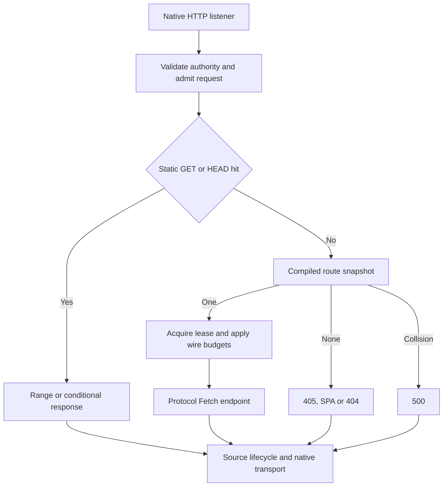

# Architecture

## Boundary

`defuss-serve` owns a listener, static content, transport conversion and endpoint composition. RPC/MCP own their wire protocols, application authorization and session policy; observability and logging are independent plugins. No runtime npm dependency, process-global routing registry or Express emulation is required. A process-wide WeakMap contains only exclusive endpoint ownership tokens and is shared across ESM/CommonJS copies; it never stores routes, sessions or application state.

## Dispatch and lifecycle

Exact route paths map to small candidate buckets; slash-delimited prefix routes use a compact list, and undeclared matchers use a separate slow path. Declared method/path routes are authoritative unless an explicit predicate further narrows them. Purely declarative endpoints do not invoke a matcher. A new route snapshot is built and published atomically after validation/startup. The common dispatcher parses the URL once; protocol-specific matchers may parse it themselves. No filesystem lookup occurs on API-only deployments or ordinary immutable manifest misses. A trie is not required for the small protocol prefix sets.

Plugin mutation operations serialize through a promise queue. A handler acquires an entry lease synchronously before its first await. The lease signal aborts on client disconnect, drain deadline or execution deadline. The Node adapter builds its Request on an abortable scope signal, so the lease reuses that Request. A per-call clone plus `AbortSignal.any` cost about a quarter of Node 22.16 server CPU for small API requests. Bun creates the Request natively, so the dispatcher clones it once to bind the lease signal. Removal unpublishes the entry immediately; a lease is held until the handler settles and its returned body completes or its cancellation settles. `AbortSignal` notifies rather than proves termination. Timeout quarantines the entry and schedules cleanup only after actual settlement. Startup hooks also have a deadline and are quarantined on timeout. One monotonic deadline covers drain and close wait for each removal/stop, after the mutation begins. Stop closes the listener and drains all entries concurrently. A stuck synchronous JavaScript function still blocks the event loop, so this is not process isolation. Separate processes are needed for hard termination guarantees.

## Transport and backpressure

Node's native HTTP/HTTPS adapter constructs one Fetch Request from validated origin-form target and Host. Forwarding headers are stripped unless the direct peer is allowlisted; the adapter never rewrites the origin based on forwarding metadata. The response pump writes Web stream chunks to Node's socket-facing buffer and awaits drain on backpressure. It preserves separate Set-Cookie fields. SSE and NDJSON flush headers immediately; other responses coalesce headers with the first chunk. The Node pump owns source completion directly, without wrapping the source. A header-only static file plan transfers its descriptor and exact byte bounds to this pump. Bun retains a single pull-based wrapper for portable streams. Counters describe source completion, not TCP acknowledgements or socket flush. Client disconnect propagates cancellation, and force-stop destroys Node sockets after the grace period.

Bun uses native `Bun.serve` with development error pages disabled and `reusePort: false`. On Bun 1.4.5, disabling development mode otherwise turns on `SO_REUSEPORT`, so a second listener on an occupied port would start and share connections instead of failing like Node. Bun owns framing for stream bodies. It drops a declared Content-Length and sends chunked for any stream body of 256 bytes or more. Every tracked Bun response, static or plugin, is such a stream. The wrapper still enforces the declared byte count.

The portable tracked path is the Bun default. Bun file-backed zero-copy remains opt-in because the adapter has no verified callback that reports native file transfer completion. `nativeStaticFastPath` permits native BunFile/slice responses when request, stream and descriptor limits and completion observation are disabled. This explicitly trades static request/source accounting for the runtime's file fast path. When the shared range decision ignores an incoming Range, a whole BunFile must not be returned because Bun could independently apply the range. Bun's native idle timer and Node's native header timeout do not have identical semantics. The Bun branches were verified with real listeners on Bun 1.4.5 for macOS arm64; other Bun versions need their own run.

Listener startup fails closed on both runtimes: neither adapter starts on an occupied port. If Node listener setup throws after the socket is bound, for example because an IPv6 zone host cannot be expressed as a URL, the adapter closes the socket before rejecting. Otherwise an unreachable listener would keep the port and the process alive.

## Static assets

Live mode resolves a canonical name and checks containment on each positive lookup. Optional bounded TTL/LRU negative cache eliminates repeated missing-file syscalls without caching access denials or unsafe positive metadata. New files can remain invisible until a negative cache entry expires; default TTL zero preserves immediate visibility. Immutable mode enumerates a deployment-owned tree at startup, stores canonical path and stat metadata, and precomputes available representation headers, MIME, cache policies and validators. Directory indexes resolve with manifest lookups, without filesystem reads. A trusted external SHA-256 manifest can supply strong representation-specific tags without runtime hashing. It denies all symlink/special-file aliases in this mode, including in-root symlinks. HEAD/conditional responses use snapshot metadata without opening files. For portable body transfer, open and fstat the selected path, verify snapshot identity/size/mtime/ctime in immutable mode, and read only selected offsets from the descriptor in demand-driven chunks of at most 256 KiB. Cancellation closes the descriptor. An immutable deployment must not change in place; metadata-only replies assume the snapshot is current. Deploy a new root and restart for new assets. An opt-in immutable filename regex grants long-lived cache headers only when the build system guarantees content versioning.

Static paths win for GET/HEAD, including terminal denials, redirects, conditional and range responses. Manifest shadow checks run at startup and registration. Live mode detects collisions at request time. Matcher-only plugins are probed on immutable paths at registration and evaluated using the real request when static resolution succeeds. Arbitrary context-dependent predicates cannot be statically proven collision-free. SPA fallback is last and does not rewrite a declared protocol path.

Realpath plus open is not equivalent to an OS sandbox against malicious concurrent directory replacement. Keep the public tree and ancestors trusted and read-only; never place private files or upload staging data inside it. Weak metadata ETags do not prove byte equality. Range parsing uses safe offsets and supports one range; invalid/multiple ranges are ignored and unsatisfiable ranges return 416.

## Security and observability

Host validation and admission run before file resolution or plugin execution. Independent request, handler, upload, stream and descriptor budgets account for distinct resource lifetimes. Per-plugin limits bound active leases. A stream is admitted only after the handler returns a body; bodyless responses do not require stream slots. Timed-out handlers retain their lease until actual settlement, even after a 504 has been sent. The global wire limit and stricter plugin limits apply to bodies consumed by endpoints; the RPC adapter also enforces the decompressed JSON limit. Body deadlines abort reads; if a response has already committed, the transport cannot change its status. Unread request bodies are not drained without bounds. CORS lists protocol headers and is not an authentication system. Node supports a native connection limit. Bun rejects a requested nonzero connection limit; configure that policy at the edge. Native listener timeout policies differ.

Validate all response header values and lengths before transmission. The listener owns hop-by-hop headers, because it frames the body and manages the connection. A Fetch body is already the decoded payload, so these fields on a plugin or `fetch()` proxy response describe another hop. As a gateway does under RFC 9110 section 7.6.1, the listener drops `Connection`, the fields it names, `Keep-Alive`, `Proxy-Connection`, `TE`, `Trailer`, `Upgrade` and a plain `Transfer-Encoding: chunked`. Rejecting them turned real responses into 500s: defuss-mcp 0.6.0 and the defuss-rpc 4.0.0 upload progress stream send `Connection: keep-alive`, and Node and Bun `fetch()` expose `Transfer-Encoding: chunked` on streamed replies. Any other transfer coding still fails the response, because `fetch()` removes only chunked framing and the body would still carry that coding. The check runs inside the header pass that validation already makes, so it adds no header lookups. The pump checks every chunk against declared Content-Length and terminates committed underflow or overflow without reusing the connection. Every cancellation and serialization-failure path must settle source resources before releasing the lease.

Observability uses bounded-cardinality identifiers (declared route, plugin name or static category), source byte totals, phase timings and counters. No request data or exception messages are logged by the core. Observers are synchronous, isolated and should remain cheap. Timestamp calls are skipped when no observer is installed.
